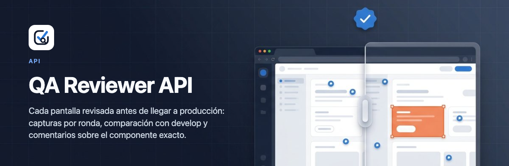
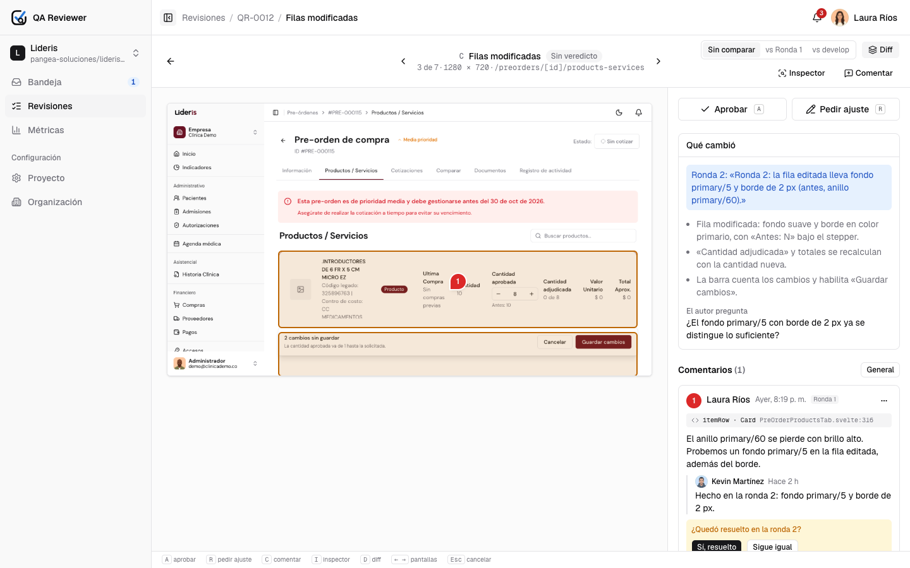
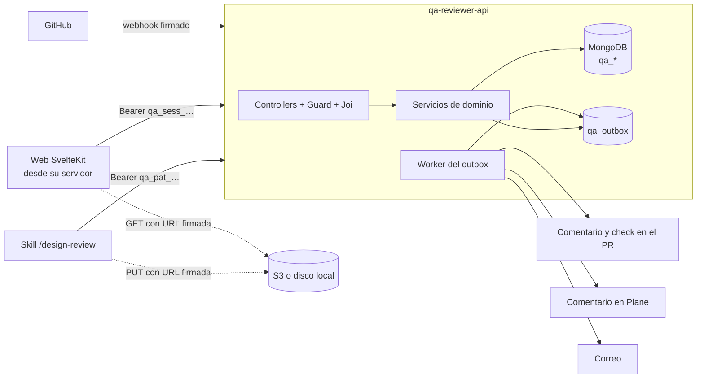
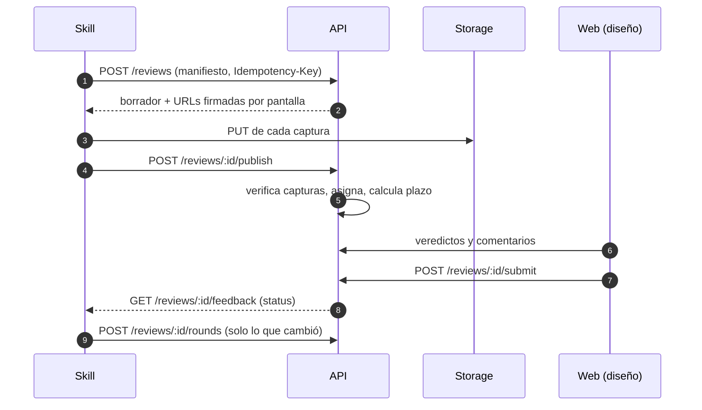

<p align="center">
  
</p>

<p align="center">
  
  
  
  
  
</p>

# QA Reviewer · API

**El servidor de QA Reviewer.** Recibe de la skill `/design-review` las pantallas que tocó una feature, guarda las capturas en S3, aplica las reglas de la revisión (rondas, veredictos, plazos, permisos) y lleva el feedback de diseño al PR de GitHub, a la tarjeta de Plane, al correo y a la sesión del dev.

La web ([`qa-reviewer`](https://github.com/kevin-martineze/qa-reviewer)) es su cliente principal:

<p align="center">
  
</p>

## Cómo encaja



Las imágenes nunca pasan por el API: firma URLs de subida y de lectura. Los efectos externos (GitHub, Plane, correo) salen por un outbox transaccional con reintentos, así un fallo de GitHub no deshace un veredicto.



## Arrancar en local

Solo hace falta Node 22 y pnpm 10: Mongo corre en memoria, las capturas se guardan en disco y el correo sale por consola.

```bash
pnpm install
pnpm demo          # API + Mongo en memoria + datos de demo en http://localhost:3000
```

- Documentación interactiva en `http://localhost:3000/docs`; contrato OpenAPI en `/docs-json`.
- Con la web: en `qa-reviewer`, `REVIEWS_SOURCE=api API_URL=http://localhost:3000 pnpm dev`.

Cuentas de demo (contraseña `demo1234`, solo en la semilla):

| Cuenta                      | Rol                                        |
| --------------------------- | ------------------------------------------ |
| `laura.rios@ejemplo.co`     | Admin de la organización · líder de diseño |
| `kevin@ejemplo.co`          | Developer en Lideris · admin en Auralis    |
| `andres.pena@ejemplo.co`    | Diseñador                                  |
| `camila.torres@ejemplo.co`  | Lectora                                    |
| `valentina.ruiz@ejemplo.co` | Owner                                      |

Con datos que sobreviven entre reinicios:

```bash
pnpm db            # terminal 1: Mongo local en .data/mongo (replica set rs0, :27017)
cp .env.example .env
pnpm seed          # borra la base y carga la demo
pnpm dev           # terminal 2: API con recarga
```

## Scripts

| Comando                                        | Qué hace                                                            |
| ---------------------------------------------- | ------------------------------------------------------------------- |
| `pnpm demo`                                    | API con Mongo en memoria y la demo cargada                          |
| `pnpm db`                                      | Mongo local persistente para desarrollo                             |
| `pnpm dev`                                     | API con recarga contra `MONGO_URI`                                  |
| `pnpm seed`                                    | Borra la base de `MONGO_URI` y carga la demo                        |
| `pnpm bootstrap`                               | Crea la organización y su owner en una base vacía (en construcción) |
| `pnpm build` · `pnpm start`                    | Compila a `dist/` y arranca en producción                           |
| `pnpm typecheck` · `pnpm lint` · `pnpm format` | Gates de calidad                                                    |
| `pnpm test`                                    | Pruebas unitarias y de integración (Jest)                           |
| `pnpm openapi`                                 | Escribe el contrato en `openapi.json` (en construcción)             |

La semilla (`seed/demo/`) se exporta desde el mock de la web con `pnpm seed:export` en `qa-reviewer`: la demo con el API muestra lo mismo que el modo mock.

## Estructura

```
src/
├── main.ts                 arranque: Fastify, /v1, helmet, CORS, Swagger, semilla
├── app.module.ts           compone los módulos según la configuración
├── config/                 variables de entorno (Joi) y Mongo en memoria
├── shared/                 infraestructura común (CoreModule, global)
│   ├── auth/               guard, principal, matriz de permisos, contraseñas
│   ├── http/               ApiError, envelope, pipe de Joi, filtro de excepciones
│   ├── schemas/            colecciones qa_* de Mongo
│   ├── events/             actividad, auditoría y notificaciones
│   ├── outbox/             eventos transaccionales y su worker
│   ├── storage/            puerto + disco local (URLs firmadas con HMAC) o S3
│   ├── mail/               puerto + consola o Resend
│   ├── docs/               Swagger y el decorador @Endpoint
│   └── util/               ids, fechas, reloj, seriales, transacciones
├── modules/                un módulo de Nest por dominio (health, auth, …)
└── seed/                   carga de la demo
seed/demo/                  datos y capturas de la demo
scripts/                    Mongo local, semilla, bootstrap
docs/                       documentación del API
```

## Hoja de ruta

| Fase | Entrega                                                                                  | Estado    |
| ---- | ---------------------------------------------------------------------------------------- | --------- |
| 1    | Base: configuración, errores, OpenAPI, permisos, storage, correo, outbox                 | Hecho     |
| 2    | Sesión, cuenta, recuperación e invitaciones                                              | Hecho     |
| 3    | Semilla de demo compartida con el mock de la web                                         | Hecho     |
| 4    | Organización, usuarios, auditoría, proyectos y miembros                                  | Hecho     |
| 5    | Revisiones y endpoints de la skill: manifiesto, idempotencia, rondas, asignación, plazos | Pendiente |
| 6    | Feedback: veredictos, envío, comentarios, menciones; notificaciones, tokens, métricas    | Pendiente |
| 7    | Integraciones (GitHub, Plane, correo), webhook y jobs (plazos, borradores, retención)    | Pendiente |
| 8    | Skill `/design-review`, pruebas de integración, CI y despliegue                          | Pendiente |

Cada fase cierra con las e2e de la web corriendo contra este API.

## Documentación

| Documento                              | Qué cuenta                                                     |
| -------------------------------------- | -------------------------------------------------------------- |
| [PRD](docs/prd.md)                     | Qué le pide el producto al API y sus requisitos no funcionales |
| [Arquitectura](docs/architecture.md)   | Módulos, capas, flujo de un request, eventos y despliegue      |
| [Patrones](docs/patterns.md)           | Patrones de diseño: dónde viven y cómo se extienden            |
| [Algoritmos](docs/algorithms.md)       | Complejidad y dónde se usa recursión                           |
| [Modelo de datos](docs/data-model.md)  | Colecciones, índices, estados y ciclo de vida                  |
| [Contrato HTTP](docs/api.md)           | Convenciones, autenticación, endpoints y catálogo de errores   |
| [Operación](docs/operations.md)        | Variables, arranque, semilla y producción                      |
| [Guía para escribir código](CLAUDE.md) | Reglas que se revisan en cada cambio                           |

Las decisiones compartidas con la web están en los [ADR de `qa-reviewer`](https://github.com/kevin-martineze/qa-reviewer/tree/main/docs/adr).

> El repo es público: nunca subas capturas con datos reales, tokens ni archivos `.env`.
